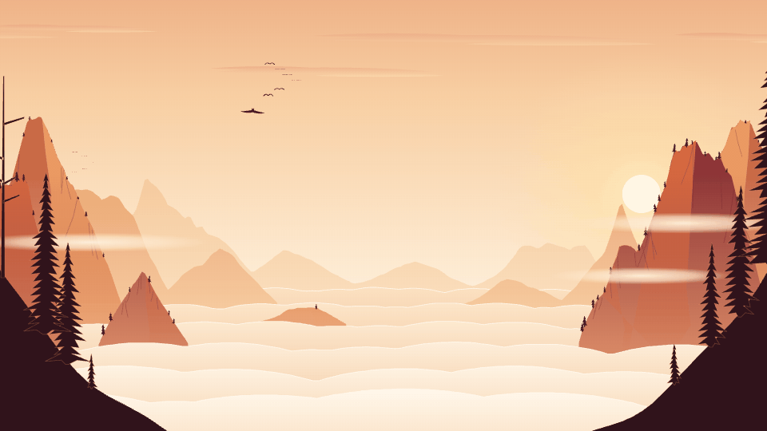

# Vista theme for the Claude desktop app

A far view for the Code tab. You look out over misty green ridges to snowy peaks, with a lake in the valley and tall pines at both sides. The sun is out, and the whole sky moves.



## What moves

- Clouds drift across at different speeds. The small low ones are far away, so they cross more slowly.
- Long rays of light fan out from the sun and slowly grow and fade.
- A flock of birds crosses the sky, and a smaller flock passes low over the peaks the other way.
- An eagle glides in a wide slow circle.
- Mist drifts between the ridges, sunlight glitters on the lake, the near pines sway, and specks of light rise near the trees.

## A new view every session

Each session draws its own view from its own seed (taken from when the session started): the shape of every ridge and peak, where the snow lies, where the trees and clouds stand. The view is drawn once and then left alone, so nothing flickers while Claude works.

The colors are a light theme with dark text. The chat column is lightly frosted, so text stays easy to read over the view.

## Install

In a terminal session, at the prompt:

```
/plugin install vista-theme --marketplace cktang88/claude-vista-theme
```

Answer `y` to add the marketplace, then pick a scope (user is fine).

From a shell:

```
claude plugin install vista-theme --marketplace cktang88/claude-vista-theme
```

In the desktop app, where `/plugin` does not run: click + next to the prompt box, then Plugins, Add marketplace with `cktang88/claude-vista-theme`, then Add plugin.

`/vista` turns the theme on again, `/vista off` clears it for the session.

Only tried on the macOS desktop app. If your system asks for reduced motion, the view stays still.

## How it is made

The whole view is one SVG drawn by code in `hooks/scene/`: no image files. The notes on what the app allows in an animated backdrop are in the README of the sister theme, [claude-garden-theme](https://github.com/cktang88/claude-garden-theme).

`hooks/make-colors.js` is the color helper that ships with Claude Code's plugin-authoring skill, copied in unchanged.
